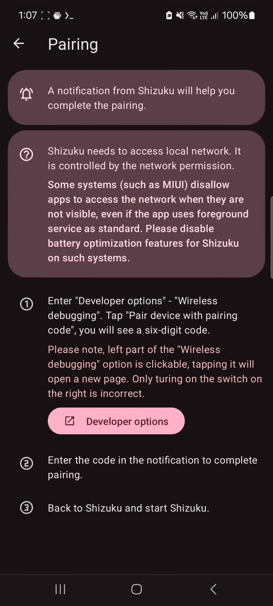

<p align="center">
  
</p>

<h1 align="center">FFlag Studio</h1>

<p align="center">
  Edit the Roblox FastFlag file on your phone — <b>no root, no PC, no adb tether</b>.
</p>

<p align="center">
  <a href="https://github.com/nani201992/fflag-studio/releases/latest"></a>
  
  
  
</p>

FFlag Studio edits the flag file the Roblox Android client actually reads:

```
/data/local/tmp/ClientAppSettings.json
```

No root: the app talks to **Shizuku**, which runs as `shell` (uid 2000), and that uid is allowed to
write `/data/local/tmp`. Every apply is written, read back, compared as canonical JSON, and only
then is the client restarted.

<p align="center">
  <a href="docs/tutorial.mp4"></a>
  <br>
  <a href="docs/tutorial.mp4"><b>▶ Watch the Shizuku setup video (55 s)</b></a>
</p>

<p align="center">
  
</p>

## Install

### 1. Start Shizuku

Install [Shizuku](https://shizuku.rikka.app/) and start it. On Android 11+ the usual way is
**wireless debugging**, which needs the phone on **Wi-Fi** — it does not work on mobile data.
Rooted phones can start Shizuku directly instead.

The video above walks through it: enable Developer options → Wireless debugging → pair → start
Shizuku, then leave Shizuku running in the background.

### 2. Install the app

Download `FFlagStudio-<version>.apk` from the [releases page](https://github.com/nani201992/fflag-studio/releases/latest)
and side-load it (allow "install unknown apps" for your browser/file manager). Android 8.0+ and
arm64 only.

### 3. Give it Shizuku access

Open FFlag Studio and press **Apply** once. Shizuku asks for permission — allow it. The status
line under the title then reads `channel: Shizuku · uid 2000`. Without that prompt, the app writes
nothing.

### 4. Add flags and apply

Add flags with **Add**, **Preset** or **JSON**, or load a `.json` pack, pick **Roblox** or **VNG**
in the `apply to` segment, then press **Apply**. The client is restarted so it re-reads the file.

If the client closes right after starting, the status says `started, then exited (crash?)` — press
**Clear all** and **Apply** to get back to an empty set.

## Screens

| Action | What it does |
|---|---|
| `Add` | Add one flag; key and value are validated before they enter the list |
| `Preset` | Your saved sets: **Save current set** → name it; tap to merge it back; `✕` deletes it |
| `JSON` | Edit the whole set as JSON; `Replace` applies the text, `.json file` loads a file |
| `Clear all` | Empties the working set; `Apply` writes an empty file |
| `Update` | Checks GitHub for a newer release; the violet banner installs it |
| `Apply` | Normalise → write → read back → compare → restart the selected client |
| search field | Filters rows by key |
| `apply to` | `Roblox` / `VNG` — both read the same file, this picks what gets restarted |
| `✕` on a row | Removes that flag (autosaved, not written until Apply) |

Flags are read by the client **at startup**, which is why Apply restarts it. A failed restart never
hides a successful write.

## Presets

Nothing ships preloaded. **Preset** → **Save current set (N flags)** stores the set you have right
now under a name; tapping that preset later **merges** it back into your list, so a full set
restores a state and a small set works as an add-on without wiping anything else. Presets live in
the app's own preferences, separate from the device file, so imports, `Clear all` and applies never
touch them.

## Updates

When a release newer than the installed build exists, a violet banner appears under the action row:
`Update v0.14 ready — tap to install`. It downloads the APK and installs it through Shizuku
(`pm install -r` as uid 2000), so no file manager is involved. The banner is hidden when you are
current; **Update** still checks on demand and reports `vX is the latest`.

## Import rules

Real flag packs are messy, so an import keeps every valid key and reports the rest instead of
refusing the file:

* `FLog` / `DFLog` are supported (integer log levels).
* a bare name that also appears prefixed in the same file is dropped — the client looks up
  `prefix + name`, so only the prefixed entry can apply.
* a bare name with no prefixed twin is written as both the `F` and the `DF` variant; the variant
  the client does not register is a no-op.
* everything else is listed with its reason.

## Flag format

```json
{ "DFIntS2PhysicsSenderRate": "38760", "FIntDebugTextureManagerSkipMips": 8 }
```

becomes

```json
{"DFIntS2PhysicsSenderRate":38760,"FIntDebugTextureManagerSkipMips":8}
```

The prefix carries type and lifetime: `Flag` bool, `Int` i64, `String`, `Log` u8; `F` is read once
at startup, `DF` can be re-read at runtime, `SF` is server-synchronised. An unknown prefix
(`{"DebugThing":true}`) or a value that does not fit its prefix is refused with a reason.

Values are typed, not scored: `"DFIntTaskSchedulerTargetFps": 99999` is legal and simply means
"don't cap me". **The app never rewrites a value you set.**

Roblox's Android cloud config
(`https://clientsettingscdn.roblox.com/v2/settings/application/AndroidApp`, ~25 500 names) is *not*
a validity list — `FFlagDebugDisplayFPS` works and is absent from it — and neither is
`libroblox.so`, because Roblox's own scripts read flags too.

## Tested on

Samsung SM-A526B (Android 14), Shizuku 13.6 running as `shell`, Roblox global 2.747.1486 and
Roblox VNG 2.746.1264. Verified end to end: apply and read-back, restart of either client,
`.json` import (valid and invalid), 30 vs 240 FPS visible in the client's FPS overlay, missing-file
first run, the failure report with probe, self-update, and a 1394-flag set scrolling in the recycled
list.

## Troubleshooting

* **`Shizuku not running`** — start Shizuku, then reopen the app; it re-checks the binder on resume.
  See the [setup video](docs/tutorial.mp4).
* **Apply failed** — the dialog shows the exact command, its stderr and a probe:
  `probe: uid=2000 tmp=drwxrwx--x write=ok file=-rw-r--r-- ctx=u:r:shell:s0`. `write=denied` means
  Shizuku's uid cannot write `/data/local/tmp`; `file=` shows the existing file's mode. Press
  **Copy** — the first line is the app version.
* **Flags applied but nothing changes** — the file is only read at client startup; let Apply
  restart it. Flags removed from a client build are written and silently ignored.
* **App info opens instead of Roblox** — that is the system's crash dialog for the client
  ("Roblox keeps stopping" → **App info**), not something this app opens. Since 0.12 the restart
  waits for `am force-stop` to finish, launches through the launcher activity, and reports when the
  client exits right after starting.
* **Update banner never appears** — you are on the latest release; press **Update** to check
  explicitly. Wireless debugging being off does not affect updates.
* **Cleared by accident** — `Clear all` only empties the editor and nothing reaches the device until
  `Apply`. The file from before the first apply is kept in app storage as
  `ClientAppSettings.json.bak` (not reachable from the UI — pull it with Shizuku).

## Limits

* One shared file: both clients read it, so there is no per-client flag set. The picker only
  chooses what gets restarted.
* Restart uses the launcher activity for the package; a Roblox build with a different package id is
  written for but not restarted automatically.
* `minSdk 26`, arm64 only (the Rust library is built for `aarch64-linux-android`).
* Release APKs are signed with a local debug keystore.

## Build from source

Everything runs on-device in Termux; no gradle, no Android SDK manager.

```sh
# 1. build tools (once)
#    android.jar + d8 + apksigner from Google's repository, Shizuku AARs from Maven Central
mkdir -p ~/apkbuild/tools ~/apkbuild/dl
cd ~/apkbuild/dl
curl -O https://dl.google.com/android/repository/build-tools_r34-linux.zip
curl -O https://dl.google.com/android/repository/platform-34-ext12_r01.zip
unzip -oq build-tools_r34-linux.zip android-14/lib/d8.jar android-14/lib/apksigner.jar
unzip -oq platform-34-ext12_r01.zip android-34-ext12/android.jar
#    Shizuku: api, provider, aidl (13.1.5), then extract classes.jar from each

# 2. Rust engine
cd rust && CARGO_TARGET_DIR=~/.cache/fflagcore cargo test
CARGO_TARGET_DIR=~/.cache/fflagcore cargo build --release

# 3. APK
./build.sh
```

`build.sh` is the whole pipeline: `aapt2 compile` → `aapt2 link --java` → `javac` → `d8` → zip
`classes.dex` + `lib/arm64-v8a/libfflagcore.so` → `apksigner`.

Signing uses `~/apkbuild/debug.keystore`; replace it (and the `--ks-*` flags) for anything you
intend to publish.

## Repo layout

```
AndroidManifest.xml        package, permissions, Shizuku provider, adaptive icon, version
build.sh                   aapt2 + javac + d8 + apksigner pipeline
res/                       adaptive icon (vector + monochrome) and colours
docs/                      README assets: logo, screenshot, Shizuku video
src/com/kizu/fflagstudio/
  MainActivity.java        UI, autosave, apply/restart, presets, JSON, import, update banner
  FlagAdapter.java         recycled row list (1300 flags → ~10 row views)
  Style.java               code-only dark theme: no XML, no AndroidX
  Core.java                JNI bridge to the Rust engine
  ShizukuShell.java        Shizuku binder shell (run, run with stdin)
  Updater.java             GitHub release check + install through Shizuku
rust/                      libfflagcore: parse/validate/canonicalise (+ 6 tests)
```

## Versioning

`versionName` lives in `AndroidManifest.xml`, is shown in the header chip and the footer, and
appears in failure reports. Each fix bumps it by 0.1 and the APK is named
`FFlagStudio-<version>.apk`, so a screenshot always identifies the build.

## Third party

* [Shizuku](https://github.com/RikkaApps/Shizuku-API) (Apache-2.0) — privileged shell channel.
* Android build tools (`aapt2`, `d8`, `apksigner`) and the platform `android.jar`.
* Rust crates: `jni`, `serde_json`.
