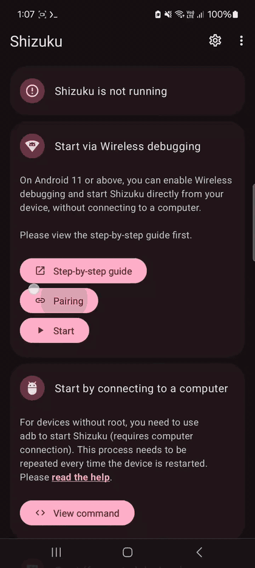
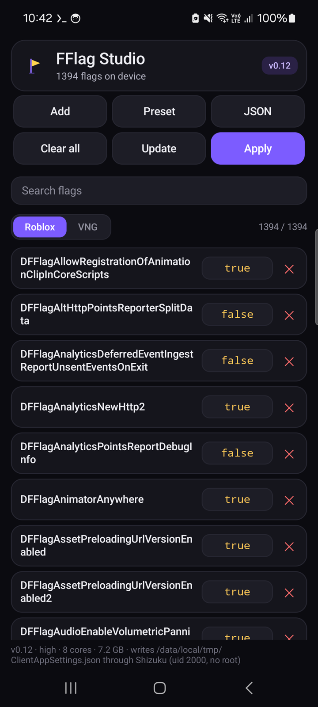

<p align="center">
  
</p>

<h1 align="center">FFlag Studio</h1>

<p align="center">
  Edit the Roblox FastFlag file on your phone — <b>no root, no PC, no adb tether</b>.
</p>

<p align="center">
  <a href="https://github.com/nani201992/fflag-studio/releases/latest"></a>
  
  
  
  <a href="LICENSE"></a>
</p>

FFlag Studio edits the flag file the Roblox Android client actually reads:

```
/data/local/tmp/ClientAppSettings.json
```

No root: the app talks to **Shizuku**, which runs as `shell` (uid 2000), and that uid is allowed to
write `/data/local/tmp`. Every apply is written, read back, compared as canonical JSON, and only
then is the client restarted.

<p align="center">
  
  <br>
  <sub><b>Shizuku setup, recorded on the phone</b> — pairing → Start → enable FFlag Studio<br>
  <a href="docs/tutorial.mp4">full quality video, 55 s</a></sub>
</p>

<p align="center">
  
</p>

## Requirements

* Android 8.0+ (API 26), any CPU the APK carries an engine for (see below).
* [Shizuku](https://shizuku.rikka.app/) installed and running, with FFlag Studio granted.
* Roblox (`com.roblox.client`) and/or Roblox VNG (`com.roblox.client.vnggames`).

The APK is **universal**: the Rust engine (`libfflagcore.so`) ships for `arm64-v8a`,
`armeabi-v7a`, `x86` and `x86_64`, so 64-bit phones, 32-bit phones and emulators all install it. If
a CPU ever lacks a build, the app still opens and reports it in the status line instead of crashing
— nothing is written in that state.

## Install

### 1. Start Shizuku

Install [Shizuku](https://shizuku.rikka.app/) and start it. Shizuku's own guide covers every
method — wireless debugging, USB with a PC, or root:
**[shizuku.rikka.app/guide/setup](https://shizuku.rikka.app/guide/setup/?night=1)**.

On Android 11+ the usual way is **wireless debugging**, which needs the phone on **Wi-Fi** — it
does not work on mobile data. Rooted phones can start Shizuku directly instead.

The [video above](docs/tutorial.mp4) walks through the same thing on the phone this app was built
on: enable Developer options → Wireless debugging → pair → start Shizuku, then leave Shizuku
running in the background.

### 2. Install the app

Download `FFlagStudio-<version>.apk` from the [releases page](https://github.com/nani201992/fflag-studio/releases/latest)
and side-load it (allow "install unknown apps" for your browser/file manager). Needs Android 8.0+
— see [Requirements](#requirements). Files with an ABI suffix (`-arm64-v8a`, `-armeabi-v7a`,
`-x86_64`, `-x86`) are the small ones the in-app updater uses; the plain name is universal.

### 3. Give it Shizuku access

Open FFlag Studio and press **Apply** once. Shizuku asks for permission — allow it. The status
line under the title then reads `channel: Shizuku · uid 2000`. Without that prompt, the app writes
nothing.

### 4. Add flags and apply

Add flags with **Add**, **Preset** or **JSON**, or load a `.json` pack, pick **Roblox** or **VNG**
in the `apply to` segment, then press **Apply**. The client is restarted so it re-reads the file.

If the client closes right after starting, the status says `started, then exited (crash?)` — press
**Clear all** and **Apply** to get back to an empty set.

## Screens

| Action | What it does |
|---|---|
| `Add` | Add one flag; key and value are validated before they enter the list |
| `Preset` | Your saved sets: **Save current set** → name it; tap to merge it back; `✕` deletes it |
| `JSON` | Edit the whole set as JSON; `Replace` applies the text, `.json file` loads a file |
| `Ask AI` | One question to any OpenAI-compatible model; grounded in how flags work — see below |
| `Clear all` | Empties the working set; `Apply` writes an empty file |
| `Update` | Checks GitHub for a newer release; the violet banner installs it |
| `Apply` | Normalise → write → read back → compare → restart the selected client |
| search field | Filters rows by key |
| `apply to` | `Roblox` / `VNG` — both read the same file, this picks what gets restarted |
| `✕` on a row | Removes that flag (autosaved, not written until Apply) |

Boolean flags (`FFlag` / `DFFlag`) show a **`true` / `false` pill** instead of a text field: tap it
to flip the value, and the change is committed like any other edit — nothing reaches the client
until `Apply`.

Flags are read by the client **at startup**, which is why Apply restarts it. A failed restart never
hides a successful write.

## Presets

Nothing ships preloaded. **Preset** → **Save current set (N flags)** stores the set you have right
now under a name; tapping that preset later **merges** it back into your list, so a full set
restores a state and a small set works as an add-on without wiping anything else. Presets live in
the app's own preferences, separate from the device file, so imports, `Clear all` and applies never
touch them.

## Ask AI

**Ask AI** puts a question to an LLM and answers inside the app: what a flag does, why a set is
behaving oddly, which keys to try. **Setup…** holds three fields — **endpoint**, **model id** and
**API key** — so it works with OpenCode Zen (the default), OpenRouter, OpenAI, Groq, or any
OpenAI-compatible server, including a local one with no key at all.

* **Endpoint** takes anything: `https://opencode.ai/zen/v1`, `https://openrouter.ai/api/v1`, a bare
  host (it appends `/v1`), or the full `…/chat/completions` URL. `Fetch` calls the matching
  `/models` and lists what the server actually offers; tap an id to use it, or type one the list
  does not show.
* **Model** is any id the endpoint accepts, not a fixed menu.
* **Key** is yours. Nothing is bundled: a key inside an APK is readable by anyone who unzips it.
  It is stored in this app's private preferences — never in the flag file, never in a draft, never
  logged — and **Reset** wipes endpoint, model and key.

The answers are grounded, not free-form. Every request carries a fixed brief on how FastFlags
actually work — prefix decides the type, `F` is read at startup and `DF` at runtime, an unprefixed
key never applies, `60` and `"60"` are the same integer, deleting a key is the only undo, Roblox and
VNG share one file, cloud config and `libroblox.so` are *not* validity lists, and the engine checks
format only, never meaning. The model also gets the slice of your current set that matches the
question, and is told to keep documented facts apart from community reports, to mark a guess as a
guess, and to answer "not sure" rather than invent a flag name. Any flags it does propose come back
as a `json` block; **Add flags** passes each one through the Rust engine first, so a malformed key
never reaches your set — and a key that passes still only proves it is well-formed, not that it does
anything.

Limits are enforced on the device so one runaway session cannot drain a key: one question every
5 s, 20 per hour, 100 per day, with the remainder shown under the button. Server errors are shown
as the server sent them — `401` key rejected, `402` no credits, `404` endpoint or model not found,
`429` rate limited.

Only the question and your matching flags leave the phone; nothing is applied until you press
**Apply**.

## Updates

When a release newer than the installed build exists, a violet banner appears under the action row:
`Update v0.14 ready — tap to install`. The banner is hidden when you are current; **Update** still
checks on demand and reports `vX is the latest`.

Each release carries a **universal APK** plus **one APK per ABI**. The updater downloads the one
matching the device (`arm64-v8a`, `armeabi-v7a`, `x86_64`, `x86`), so an update is ~200–230 KB
instead of ~700 KB, and installs it through Shizuku as uid 2000:

1. the file is written to the app's external files dir and `pm install -r <path>` runs as uid 2000,
   so nothing is copied through the Shizuku channel;
2. if the shell cannot read that path, it falls back to pushing the APK as base64 over Shizuku's
   stdin — slower, but it always works.

Either way there is no "unknown sources" prompt and no file manager.

## Import rules

Real flag packs are messy, so an import keeps every valid key and reports the rest instead of
refusing the file:

* `FLog` / `DFLog` are supported (integer log levels).
* a bare name that also appears prefixed in the same file is dropped — the client looks up
  `prefix + name`, so only the prefixed entry can apply.
* a bare name with no prefixed twin is written as both the `F` and the `DF` variant; the variant
  the client does not register is a no-op.
* everything else is listed with its reason.

## Flag format

```json
{ "DFIntS2PhysicsSenderRate": "38760", "FIntDebugTextureManagerSkipMips": 8 }
```

becomes

```json
{"DFIntS2PhysicsSenderRate":38760,"FIntDebugTextureManagerSkipMips":8}
```

The prefix carries type and lifetime: `Flag` bool, `Int` i64, `String`, `Log` u8; `F` is read once
at startup, `DF` can be re-read at runtime, `SF` is server-synchronised. An unknown prefix
(`{"DebugThing":true}`) or a value that does not fit its prefix is refused with a reason.

Values are typed, not scored: `"DFIntTaskSchedulerTargetFps": 99999` is legal and simply means
"don't cap me". **The app never rewrites a value you set.**

Roblox's Android cloud config
(`https://clientsettingscdn.roblox.com/v2/settings/application/AndroidApp`, ~25 500 names) is *not*
a validity list — `FFlagDebugDisplayFPS` works and is absent from it — and neither is
`libroblox.so`, because Roblox's own scripts read flags too.

## Tested on

Samsung SM-A526B (Android 14), Shizuku 13.6 running as `shell`, Roblox global 2.747.1486 and
Roblox VNG 2.746.1264. Verified end to end: apply and read-back, restart of either client,
`.json` import (valid and invalid), 30 vs 240 FPS visible in the client's FPS overlay, missing-file
first run, the failure report with probe, self-update, and a 1394-flag set scrolling in the recycled
list.

## Troubleshooting

* **`Shizuku not running`** — start Shizuku, then reopen the app; it re-checks the binder on resume.
  See the [setup video](docs/tutorial.mp4) or Shizuku's
  [setup guide](https://shizuku.rikka.app/guide/setup/?night=1).
* **Apply failed** — the dialog shows the exact command, its stderr and a probe:
  `probe: uid=2000 tmp=drwxrwx--x write=ok file=-rw-r--r-- ctx=u:r:shell:s0`. `write=denied` means
  Shizuku's uid cannot write `/data/local/tmp`; `file=` shows the existing file's mode. Press
  **Copy** — the first line is the app version.
* **Flags applied but nothing changes** — the file is only read at client startup; let Apply
  restart it. Flags removed from a client build are written and silently ignored.
* **App info opens instead of Roblox** — that is the system's crash dialog for the client
  ("Roblox keeps stopping" → **App info**), not something this app opens. Since 0.12 the restart
  waits for `am force-stop` to finish, launches through the launcher activity, and reports when the
  client exits right after starting.
* **Install says `INSTALL_FAILED_NO_MATCHING_ABIS`** — only `arm64-v8a`, `armeabi-v7a`, `x86` and
  `x86_64` engines are built in; an exotic CPU (riscv64, mips) has none yet.
* **Update banner never appears** — you are on the latest release; press **Update** to check
  explicitly. Wireless debugging being off does not affect updates.
* **Cleared by accident** — `Clear all` only empties the editor and nothing reaches the device until
  `Apply`. The file from before the first apply is kept in app storage as
  `ClientAppSettings.json.bak` (not reachable from the UI — pull it with Shizuku).

## Limits

* One shared file: both clients read it, so there is no per-client flag set. The picker only
  chooses what gets restarted.
* Restart uses the launcher activity for the package; a Roblox build with a different package id is
  written for but not restarted automatically.
* Release APKs are signed with a local debug keystore.

## Build from source

Everything runs on-device in Termux; no gradle, no Android SDK manager.

```sh
# 1. build tools (once)
#    android.jar + d8 + apksigner from Google's repository, Shizuku AARs from Maven Central
mkdir -p ~/apkbuild/tools ~/apkbuild/dl
cd ~/apkbuild/dl
curl -O https://dl.google.com/android/repository/build-tools_r34-linux.zip
curl -O https://dl.google.com/android/repository/platform-34-ext12_r01.zip
unzip -oq build-tools_r34-linux.zip android-14/lib/d8.jar android-14/lib/apksigner.jar
unzip -oq platform-34-ext12_r01.zip android-34-ext12/android.jar
#    Shizuku: api, provider, aidl (13.1.5), then extract classes.jar from each

# 2. Rust engine: tests, then one cdylib per ABI
pkg install rust-src ndk-multilib          # cross std source + bionic sysroots
cd rust && CARGO_TARGET_DIR=~/.cache/fflagcore cargo test
sh build-android.sh                        # aarch64, armv7, x86_64, i686

# 3. APK (packs every libfflagcore.so it finds)
./build.sh
```

`build-android.sh` compiles `std` from `rust-src` for the three ABIs Termux does not ship prebuilt
and links them against `ndk-multilib`'s bionic sysroots; arm64 uses the prebuilt `std`.
`build.sh` packs whichever ABIs were built and refuses to produce an APK without arm64.

`build.sh` itself is the whole pipeline: `aapt2 compile` → `aapt2 link --java` → `javac` → `d8` → zip
`classes.dex` + `lib/arm64-v8a/libfflagcore.so` → `apksigner`.

Signing uses `~/apkbuild/debug.keystore`; replace it (and the `--ks-*` flags) for anything you
intend to publish.

## Repo layout

```
AndroidManifest.xml        package, permissions, Shizuku provider, adaptive icon, version
build.sh                   aapt2 + javac + d8 + apksigner pipeline
res/                       adaptive icon (vector + monochrome) and colours
docs/                      README assets: logo, screenshot, Shizuku video
src/com/kizu/fflagstudio/
  MainActivity.java        UI, autosave, apply/restart, presets, JSON, import, update banner
  FlagAdapter.java         recycled row list (1300 flags → ~10 row views)
  Style.java               code-only dark theme: no XML, no AndroidX
  Core.java                JNI bridge to the Rust engine
  ShizukuShell.java        Shizuku binder shell (run, run with stdin)
  Updater.java             GitHub release check + install through Shizuku
rust/                      libfflagcore: parse/validate/canonicalise (+ 6 tests)
  build-android.sh         cross-builds the engine for arm64, armv7, x86_64 and i686
```

## Versioning

`versionName` lives in `AndroidManifest.xml`, is shown in the header chip and the footer, and
appears in failure reports. Each fix bumps it by 0.1 and the APK is named
`FFlagStudio-<version>.apk`, so a screenshot always identifies the build.

## License

**MIT** — see [LICENSE](LICENSE). Free to use, modify, fork and redistribute, including
commercially; keep the copyright notice and the permission text with any copy or substantial part.
There is no warranty: flags are written to your own device at your own risk.

The release APKs are covered by the same licence. Bundled third-party components keep their own
terms (below).

## Third party

* [Shizuku](https://github.com/RikkaApps/Shizuku-API) (Apache-2.0) — privileged shell channel.
  Setup: [guide](https://shizuku.rikka.app/guide/setup/?night=1).
* Android build tools (`aapt2`, `d8`, `apksigner`) and the platform `android.jar`.
* Rust crates: `jni`, `serde_json`.
